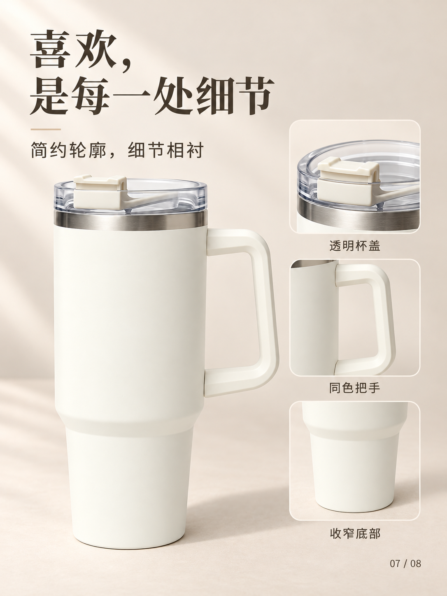

# 电商详情图生成 · Ecommerce Detail Images

**中文** | [English](README.en.md)

将商品照片或文字描述，转成一套风格统一、可逐张修改的电商详情图。

`ecommerce-detail-images` 是一个面向 Codex 的 Skill。它负责分析商品、设计整套视觉、规划每页内容、编写完整提示词、调用图像工具出图，并检查和保存结果。你可以指定奶油极简、黑金科技、杂志排版等风格，也可以提供自己的风格参考图。

**它是工作流 Skill，不是独立软件或图像模型。实际出图需要当前运行环境提供图像生成/编辑工具。**

## 成图示例

以下是使用真实商品参考图生成的保温杯案例：8 张、3:4 竖版、中文文案、奶油极简风。这里展示其中 4 张。

| 主视觉 | 杯盖特写 |
|---|---|
|  |  |

| 细节总览 | 桌面场景 |
|---|---|
|  |  |

本次实测生成了 8 个独立 PNG 文件，每张 1086 × 1448 像素。该尺寸是这次运行的结果，不是所有环境的固定输出规格。商品外观以参考图为依据，没有加入未提供的容量、保温时长或材质牌号。

## 能做什么

- **图片输入**：上传商品正面、侧面或细节图，以真实商品外观为生成依据。
- **文字输入**：描述商品外形、颜色、结构，先建立统一外观基准，再生成整套图。
- **风格定制**：指定配色、背景、字体气质、光线、图文布局、文案密度和参考风格。
- **整套生成**：主视觉、卖点、场景、细节、规格或说明页，按商品资料灵活安排。
- **按页修改**：只重做指定图片，保留其他页面和已有版本。
- **多种工作方式**：直接出完整套图、先做样张、只出方案和提示词，或继续未完成任务。
- **事实约束**：没有提供的参数不会自动变成卖点；参考图不能证明的材质、功效和认证不会凭空补齐。

## 使用前准备

| 条件 | 说明 |
|---|---|
| 支持 Skill 的运行环境 | 本项目主要针对 Codex；成图案例在提供内置图像工具的 Codex 桌面环境中完成 |
| 可用的图像生成/编辑工具 | 默认使用内置 `image_gen`；安装 Skill 不会自动为账号启用该工具 |
| 商品资料 | 至少一张商品图，或足够清楚的商品描述 |
| 文件访问能力 | 要保存本地图片，运行环境需能读取参考图并写入输出目录 |
| Git 或 ZIP 解压工具 | 仅用于手动安装，任选其一 |

内置出图路径不需要额外填写 API Key，但使用额度、速度和可用性由宿主环境决定。本仓库不提供 API 额度、不指定订阅方案，也不包含独立 API 客户端。没有图像工具时，可以完成方案和提示词；不能把这些文字文件当作已经生成的图片。

核心工作流说明目前以中文编写，支持用中文或英文发出请求，并按请求指定的语言生成文案。英文完整套图尚未单独做视觉实测。其他支持 `SKILL.md` 的工具可能能读取说明，但工具名称和参考图传入方式需要适配，不能承诺安装后直接出图。

## 安装

选择下面一种方法即可，避免在多个目录重复安装同名 Skill。

### 方法一：让 Codex 安装

如果你的 Codex 提供 `$skill-installer`，把以下内容直接发送到聊天中：

```text
使用 $skill-installer，从 https://github.com/jovanjianga/ecommerce-detail-images 安装 Skill。
Skill 位于仓库根目录，repo path 为 "."，安装名称为 ecommerce-detail-images。
```

供安装器识别的参数是 `--repo jovanjianga/ecommerce-detail-images --path . --name ecommerce-detail-images`。这是安装器参数，不是让你在终端直接运行的命令。

### 方法二：使用 Git 安装

**macOS / Linux：**

```bash
mkdir -p "$HOME/.agents/skills"
git clone https://github.com/jovanjianga/ecommerce-detail-images.git \
  "$HOME/.agents/skills/ecommerce-detail-images"
```

**Windows PowerShell：**

```powershell
$ecomSkillRoot = Join-Path $env:USERPROFILE ".agents\skills"
New-Item -ItemType Directory -Force -Path $ecomSkillRoot | Out-Null
git clone https://github.com/jovanjianga/ecommerce-detail-images.git (Join-Path $ecomSkillRoot "ecommerce-detail-images")
```

目标目录已存在时，不要覆盖自己修改过的文件，先按后面的更新说明处理。

### 方法三：下载 ZIP

1. 在 GitHub 仓库点击 **Code → Download ZIP**。
2. 解压，将解压后的根目录重命名为 `ecommerce-detail-images`。
3. 将整个目录放入 `~/.agents/skills/`；Windows 为 `%USERPROFILE%\.agents\skills\`。
4. 确认最终路径是 `~/.agents/skills/ecommerce-detail-images/SKILL.md`，中间没有多套一层仓库目录。
5. 保留 `references/` 和 `agents/`，不要只复制一个 `SKILL.md`。

较早安装器可能使用 `$CODEX_HOME/skills`，默认是 `~/.codex/skills`。本项目的本地案例使用了这个兼容路径；如果已经在那里安装，不要为了 README 再装一份。新手动安装采用官方文档列出的 `~/.agents/skills`。路径与刷新行为见 [Codex Skill 官方说明](https://learn.chatgpt.com/docs/build-skills#where-to-save-skills)。

### 检查安装是否成功

安装后，在下一条消息中输入 `$ecommerce-detail-images`，或用你的客户端的 Skill 选择器查找名称。Codex CLI/IDE 可用 `/skills` 查看。Codex 会自动检测 Skill 变化；如果没有出现，重启客户端后再试。

Skill 名称能被找到，只能证明安装成功；还需要当前会话具备图像工具，才能完成实际出图。

## 第一次使用：四步完成

1. **打开用于保存结果的工作目录。** 也可以在请求中指定输出目录。
2. **上传商品照片。** 正面图即可开始；多角度照片能提供更充分的细节依据。没有照片也可以输入商品描述。
3. **发送制作要求。** 写出商品是什么、需要多少张、风格、比例和文案语言；没写的选项会使用默认值。
4. **等待生成与检查。** Skill 会建立视觉规则、规划页面、逐张出图并保存；除非要求先看样张，否则不会每张都等待确认。

最简单的完整请求：

```text
使用 $ecommerce-detail-images，根据上传的商品图制作 8 张详情图。
商品是保温杯，采用奶油极简风，3:4 竖版，中文文案，多展示杯盖、把手和杯身细节。
直接生成完整套图，不添加没有提供的容量、保温时长或材质信息。
```

上传了多张不同用途的图片时，明确写出：「图 1、2 是同一商品的不同角度，图 3 仅供风格参考，图 4 是品牌 Logo。」

## 可以指定哪些选项

这些是自然语言要求，不是命令行参数，无需按固定格式填写。

| 选项 | 可写的内容 | 不指定时 |
|---|---|---|
| 张数 | 4 / 6 / 8 / 10 张等 | 10 张 |
| 比例 | 3:4、9:16、1:1 等 | 9:16 竖版 |
| 风格 | 奶油极简、黑金科技、国风、杂志、活泼彩色等 | 根据商品选择清楚、克制的电商视觉 |
| 配色 | 品牌色、HEX 色值、背景色、强调色 | 优先品牌色，其次商品色 |
| 排版 | 大字、左对齐、居中、信息卡、少文字、多留白 | 每页一个主要信息点，层级清楚 |
| 字体 | 宋体气质、现代黑体、精致衬线等 | 与整体风格相符 |
| 语言 | 中文、英文、中英双语 | 跟随请求语言 |
| 页面内容 | 指定每页主题，要求若干张细节特写 | 根据已有资料安排 |
| 品牌 | 品牌名、现有 Logo 和摆放要求 | 未提供则省略，不新造品牌 |
| 流程 | 直接整套、先样张、只出提示词 | 直接生成整套 |
| 输出位置 | 指定本地目录 | 当前工作区的 `output/ecommerce-detail-images/` |
| 修改范围 | 改某页、某段文字或整套风格 | 按本次请求的范围修改 |

参考图约束和文字描述不能保证像素级复刻；指定字体气质也不等于获得可编辑字体图层。精确分辨率取决于图像工具，Skill 会检查实际输出，不把“3:4”自动解释成某个固定像素尺寸。

## 10 类使用示例

### 1. 商品照片直接生成整套

附件：一张或多张同款保温杯照片。

```text
使用 $ecommerce-detail-images，基于这些保温杯照片生成 8 张商品详情图。
奶油极简风，3:4，中文。安排 1 张主图、5 张细节图、1 张总览和 1 张桌面场景。
保留杯型、杯盖、把手和颜色；不添加 Logo、吸管或未经提供的参数。
```

### 2. 只有文字描述，没有商品照片

```text
使用 $ecommerce-detail-images，制作 6 张马克杯详情图。
商品是浅绿色哑光陶瓷杯，圆柱杯身、C 形把手，没有品牌或图案。
采用米白极简风、3:4、中文。先建立统一商品外观，再用于整套图。
我没有提供容量和尺寸，不写这些参数。
```

此模式生成的是根据描述设计的概念外观，不能保证与未展示的真实商品完全一致。

### 3. 用另一张图指定视觉风格

附件：图 1 是商品，图 2 是你喜欢的海报。

```text
使用 $ecommerce-detail-images，为图 1 的运动鞋做 6 张详情图。
图 2 只参考它的深色背景、侧面光和大标题排版。
保留图 1 的鞋型、鞋带、鞋底和配色，不复制图 2 的商品、Logo 或文案。
4:5 竖版，中文，重点展示鞋面和鞋底外观。
```

### 4. 使用品牌 Logo 和精确文案

附件：商品图、品牌 Logo 文件。

```text
使用 $ecommerce-detail-images，制作 6 张帆布袋详情图。
使用上传的 Logo，固定放在左上角，小尺寸；背景 #F5F1E8，文字 #38342E。
首屏标题必须是“把日常轻轻装好”，副标题是“简约帆布袋”。
中文，3:4，留白多，其他页面围绕袋型、提手和图案展开。
```

### 5. 自定义每张图的任务

```text
使用 $ecommerce-detail-images，基于商品照片做 6 张详情图，按以下顺序：
1. 完整产品主视觉
2. 杯盖局部
3. 把手局部
4. 杯身表面
5. 下部造型
6. 桌面使用场景
统一奶油极简风，3:4，中文。不需要参数表和购买按钮。
```

### 6. 先看一张样图，再继续

```text
使用 $ecommerce-detail-images，最终需要 8 张保温杯详情图。
先只生成第 1 张主视觉，奶油极简风、3:4、中文，等我反馈后再生成剩余 7 张。
```

满意后继续：

```text
沿用这张的色调、字体和光线，继续生成剩余 7 张。
仍然以最初上传的商品图为外观依据。
```

### 7. 只生成方案和提示词

```text
使用 $ecommerce-detail-images，为上传的商品规划 8 张详情页。
这次只输出页面方案、每页中文文案和完整生图提示词，不调用图像工具。
每条提示词必须可独立使用，写清产品约束、背景、光线和排版。
```

### 8. 单页修改，保留其余图片

在原会话中直接说；换会话时提供原输出目录或待改图片：

```text
继续使用 $ecommerce-detail-images。只修改第 3 张：
把标题改成“同色把手，简约有型”，缩小一点文字，增加左侧留白。
商品和背景保持不变，其余 7 张不重做，保存一个新版本。
```

### 9. 英文文案或中英双语

```text
Use $ecommerce-detail-images to create 6 product detail images
from the attached product photos. Use a warm minimalist style,
a 3:4 portrait layout, and English copy only.
Focus on visible product details. Do not invent specifications or claims.
```

双语也可这样写：

```text
使用 $ecommerce-detail-images，做 6 张中英双语详情图。
中文为主标题，英文为简短副标题；每页只突出一个信息点，避免文字拥挤。
```

### 10. 从中断任务继续

```text
使用 $ecommerce-detail-images，继续输出目录中的未完成任务。
先读取 plan.md、prompts.md 和 delivery.md，并检查现有图片。
只补齐缺失或标记为需修正的页面，不重做已经检查通过的图片。
```

## 可复制的需求模板

删除不需要的行，填写你知道的信息即可：

```text
使用 $ecommerce-detail-images 制作商品详情图。

商品：
参考图分工：
真实卖点和参数：
品牌 / Logo：
需要张数：
画幅比例：
风格 / 参考方向：
主色 / 背景 / 字体：
文案语言：
必须出现的文案：
每页内容或重点细节：
需要保持的产品特征：
不希望出现的元素：
直接整套 / 先样张 / 仅提示词：
输出目录：
```

## 你会得到什么

典型输出目录如下；具体扩展名保留图像工具返回的格式：

```text
output/ecommerce-detail-images/商品短名-本次标识/
├── plan.md        # 商品事实、视觉规则、页面分工
├── prompts.md     # 每张图可独立使用的完整提示词
├── delivery.md    # 文件清单、检查状态、未解决项
└── images/
    ├── 01-hero.png
    ├── 02-detail.png
    ├── ...
    └── 03-detail-v2.png  # 修改后的版本（如有）
```

默认交付独立图片；需要 ZIP 可以明确提出。长图拼接、上传店铺、发布商品和自动接入收费 API 不属于默认流程。若宿主只返回内联图片而没有本地文件，Skill 会展示实际结果并说明保存限制，不虚构文件路径。

## 常见问题

**为什么装好了却没有生成图片？**

先确认本次会话是否提供图像生成工具。Skill 文件只能描述工作流，不能自行安装模型或授予工具权限。没有工具时可改为只生成方案和提示词。

**可以只给一张图吗？**

可以。页面会围绕图中能确认的外观安排；看不到的内部结构和背面细节不会被当作真实事实。需要精确展示更多角度时，补充对应商品照片。

**如何保证八张图像同一款商品？**

每页以原始商品图为外观依据，再参考已检查的首屏统一视觉。这个方法可以降低漂移，但仍需逐张检查关键结构、颜色、商标和文字。

**会自动写容量、保温时间或认证吗？**

不会。只有你提供可靠资料时才写入。缺少这些信息时会使用外观、场景等页面替代参数页。

**中文文字有错，或者产品细节变了怎么办？**

指出页码和具体位置，要求只修正该页。Skill 会用图像编辑工具针对性修改并保留旧版；难以修复的页面会标记为需修正，不会冒充完成。

**每一张都需要我确认吗？**

默认不需要。只有你要求“先样张”“先看方案”时才在相应步骤等待反馈。

**可以一次做多个商品吗？**

可以明确分组输入，并要求每个商品使用独立输出目录和独立参考图。不要把不同款式混在同一套一致性约束中。建议首次先完成一个商品，检查风格后再扩展。

**需要付费吗？需要 API Key 吗？**

Skill 按 MIT 许可提供。实际图像生成可能消耗宿主服务的额度；内置路径无需额外 API Key。不会因工具失败就自动切到收费 API。

**生成后能直接上传店铺吗？**

交付的是图片文件，不会自动上架。发布前检查实际商品一致性、文字和平台要求的文件尺寸；如果要调整，请明确说明。

## 更新与卸载

Git 安装的用户可在没有未提交自定义改动时执行：

```bash
git -C "$HOME/.agents/skills/ecommerce-detail-images" pull --ff-only
```

PowerShell：

```powershell
git -C (Join-Path $env:USERPROFILE ".agents\skills\ecommerce-detail-images") pull --ff-only
```

如果 Git 提示本地修改或分支分歧，先保存自己的改动，不要用强制重置覆盖。ZIP 或安装器下载的目录可能不含 `.git`，请先备份到 Skill 扫描目录之外，再用原安装方式更新；不要直接在旧目录旁放一个同名 Skill 的备份。

卸载时将 `ecommerce-detail-images` 整个文件夹移出 Skill 目录，或删除自己不再需要的安装副本；项目输出图片仍保存在原工作目录。若列表没有及时刷新，重启 Codex。

## 仓库结构

```text
ecommerce-detail-images/
├── README.md
├── README.en.md
├── LICENSE
├── SKILL.md
├── agents/openai.yaml
├── references/
│   ├── style-guide.md
│   ├── prompt-patterns.md
│   └── generation.md
└── examples/thermos-cup/   # README 展示用的 4 张实测成图
```

## 反馈与许可

发现安装、参考图一致性或提示词问题，可在 [Issues](https://github.com/jovanjianga/ecommerce-detail-images/issues) 提供环境、最小复现请求、期望结果和实际表现。提交图片前自行确认适合公开分享。

本项目采用 [MIT License](LICENSE)。仓库许可不替代第三方商标、字体、上传素材或图像服务本身的使用条款。

工作流思路参考了 [沐阳关于电商详情图提示词的帖子](https://x.com/yyyole/status/2002724036355240392)，本项目将其扩展为可配置、可检查、可逐页修改的 Skill，没有复制整套原文提示词。
